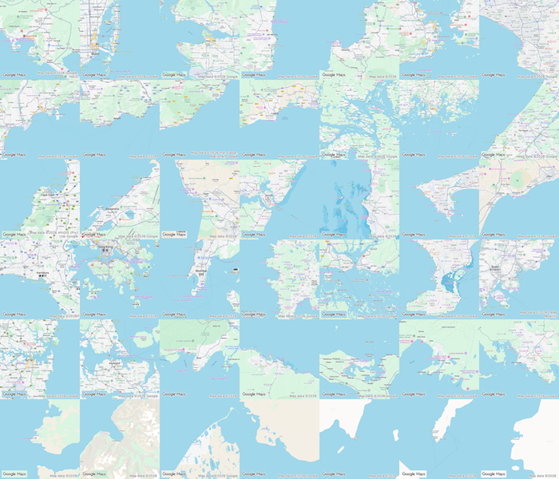

# Coastlines — Atlas des côtes

**42 vues de littoraux dans une mosaïque interactive.**

Vues des côtes : Amériques, de l’Europe, de l’Afrique, de l’Asie, de l’Australie/Océanie, et les régions polaires.

Les cartes sont recadrées en carrés et présentent une échelle physique comparable au centre de chaque vue.

## Fonctionnalités

- **Classer** les images par région, par pays, au hasard ou selon leur ordre initial.
- **Composer** une grille de 6 × 7, 7 × 6, 14 × 3… Le mode automatique adapte la disposition à la fenêtre ; les 42 images restent visibles.
- **Faire pivoter** une image de 90° dans le sens horaire à chaque clic.
- **Mode noir et blanc** pour comparer les formes des littoraux.
- **Enregistrer** la mosaïque avec « Save image », puis « Download PNG ». L’export conserve la disposition, l’ordre, les rotations et le mode de couleur.

## Sources

Les vues proviennent de **Google Maps**. Les crédits de Google et des fournisseurs de données sont conservés sur chaque carte.

## Version live  

https://ereyes.github.io/coastlines/ 

## Collage  
https://ereyes.github.io/coastlines/collage001.jpeg  

